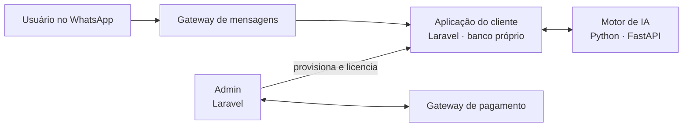

# Plataforma compl_t v1: SaaS multi-cliente com IA integrada com segurança

> Estudo de caso de engenharia de software, por **Filipe Lira**. O código é privado; aqui estão **a arquitetura, as decisões e o resultado**.

---

## Em uma frase

Uma plataforma SaaS modular (agenda, controle de ponto e chamados) em que cada cliente liga os módulos que contrata, com um atendente de IA no WhatsApp que executa ações reais no sistema.

## Meu papel

Arquitetura e construção de todas as peças: admin e site, aplicação do cliente, motor de IA, integrações de pagamento e de mensagem, infraestrutura e deploy.

## Arquitetura

## Desafios de engenharia

| Desafio | Como resolvi |
|---|---|
| **Usar IA sem deixar a IA gravar dado** | o modelo de linguagem só **escolhe** uma ação de uma lista fechada; quem valida e executa é a aplicação. Resposta não determinística nunca vira dado direto. |
| **IA que não inventa** | a busca em documentos tem um limite mínimo de confiança, **calibrado com dados reais**; abaixo dele, o atendente diz que não sabe. Isolamento entre clientes testado. |
| **Trocar de modelo sem mexer na aplicação** | motor de IA em serviço Python separado, atrás de um contrato HTTP. |
| **Muitos clientes, um código** | um banco por cliente, provisionado por comando; atualização por tag, aplicada a todos os clientes de uma vez. |
| **Cobrança que manda no acesso** | licença por módulo, assinatura recorrente e webhook que libera ou bloqueia o acesso sozinho, sem acesso cruzado entre bancos. |
| **Custo de IA** | embeddings gerados no próprio servidor: custo zero por documento e dado do cliente fora de terceiros. |

## A decisão de parar

Com a plataforma no ar, decidi **focar num produto só** ([pep-case](https://github.com/filipelira1/pep-case)). Três módulos genéricos competiam com ferramentas maduras; o foco num produto trazia mais valor com o mesmo esforço.

O que foi reaproveitado: isolamento por banco, provisionamento por comando, versões com tag e backup, e o processo de trabalho. Saber **desligar o que funciona para apostar no que importa** foi a lição mais útil deste projeto.

## Resultado

| | |
|---|---|
| Período | janeiro a outubro de 2026 |
| Versões | 10 (`v1.0.0` a `v1.0.9`) |
| Peças | 4 serviços (admin/site, aplicação do cliente, motor de IA, gateway de mensagens) |

## Stack

PHP 8.3 · Laravel · Vue · Python · FastAPI · PostgreSQL + pgvector · Redis · Docker · webhooks de pagamento · WhatsApp

**Demonstração e detalhes:** sob pedido, numa conversa.

## Outros cases

[pep-case](https://github.com/filipelira1/pep-case) · [crm-case](https://github.com/filipelira1/crm-case) · [mermaid-case](https://github.com/filipelira1/mermaid-case)

---

*Sou **Filipe Lira**, engenheiro de software em São Paulo (ABC Paulista). [LinkedIn](https://www.linkedin.com/in/filipe-lira-a54217167) · [GitHub](https://github.com/filipelira1)*
